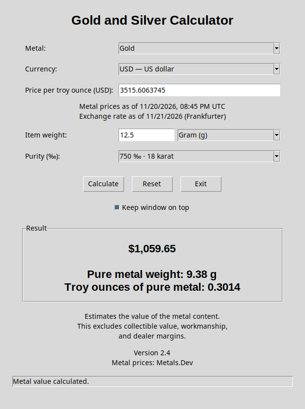

# Gold and Silver Calculator

[Deutsch](README.md) · [Español](README.es.md)

A free desktop **gold and silver value calculator** for coins, bullion bars
and jewelry. Enter a weight, choose the gold karat or silver fineness, and
use the reference metal price per troy ounce or enter your own price. The
calculator shows the estimated metal value, pure metal weight and troy ounces.

## Linux screenshot



## Download

[Download version 2.4](https://github.com/media-vm/gold-silber-rechner/releases/tag/v2.4)

- [Windows 10 and 11 (64-bit portable EXE)](https://github.com/media-vm/gold-silber-rechner/releases/download/v2.4/Gold-Silver-Calculator-2.4-Windows-x64.exe)
- [Windows 7 (32-bit compatibility EXE)](https://github.com/media-vm/gold-silber-rechner/releases/download/v2.4/Gold-Silver-Calculator-2.4-Windows7-x86.exe)
- [Debian and Ubuntu (DEB)](https://github.com/media-vm/gold-silber-rechner/releases/download/v2.4/gold-silber-rechner_2.4-1_all.deb)
- [Snap Store (Linux, AMD64 and ARM64)](https://snapcraft.io/gold-silber-rechner)

English, German and Spanish use the same downloads. The application uses your
system language. To select English explicitly, launch the executable or
`gold-silber-rechner` with `--lang en`. On Windows, the portable executable
includes its Python runtime. Both EXEs are signed with Volker Andreas Müller’s
self-signed certificate and a DigiCert timestamp.

## Currencies and units

| Currency | Country or region |
|---|---|
| US dollar (USD) | United States |
| Pound sterling (GBP) | United Kingdom |
| Indian rupee (INR) | India |
| Pakistani rupee (PKR) | Pakistan |
| Nigerian naira (NGN) | Nigeria |
| Philippine peso (PHP) | Philippines |
| Tanzanian shilling (TZS) | Tanzania |
| South African rand (ZAR) | South Africa |
| Kenyan shilling (KES) | Kenya |
| Ugandan shilling (UGX) | Uganda |
| Euro (EUR) | Euro area |

Use grams, kilograms, pounds, ordinary ounces or troy ounces. The price field
always uses **price per troy ounce**, regardless of the weight unit selected.
The English interface uses a decimal point and accepts numbers such as
`1,234.56`. Sterling silver is listed as **925 ‰**. Common gold grades include
**750 ‰ · 18 karat** and **585 ‰ · 14 karat**.

The app uses Linuga’s gold and silver prices and Frankfurter’s reference
exchange rates. The calculation estimates metal content value. Collectible
value, workmanship and dealer margins are outside the estimate.

## Run from source

Install Python and Tkinter, then install the dependencies in a virtual
environment and choose English:

```sh
python -m pip install -r requirements.txt
python gold-silver-value-calculator-german-v2.2.py --lang en
```

The project is available under the [MIT license](LICENSE).
