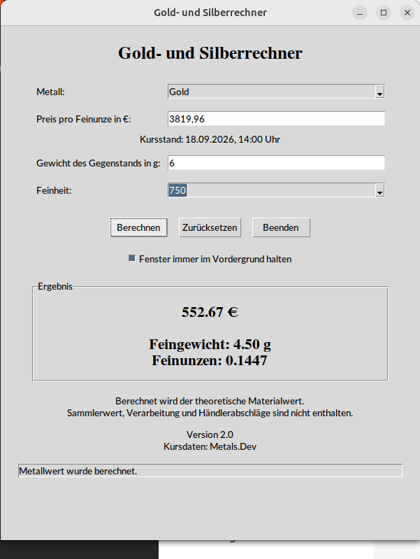
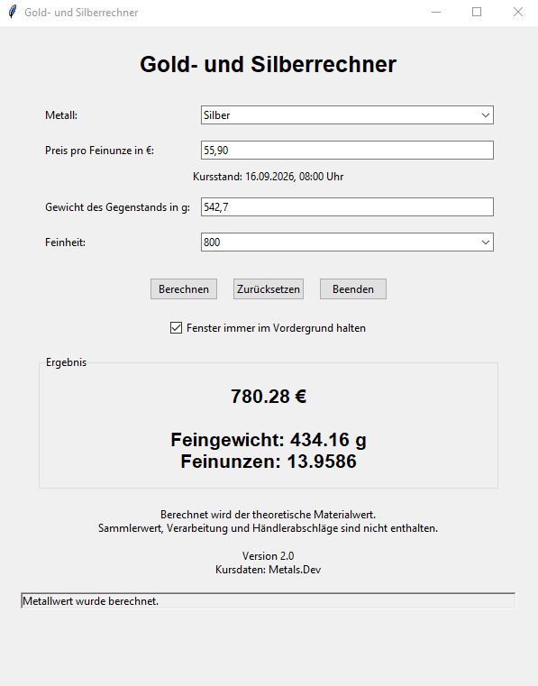

# Gold- und Silberrechner

Der **Gold- und Silberrechner** ist eine kostenlose Anwendung zur Berechnung des Materialwerts von Gold und Silber anhand aktueller Edelmetallkurse.

Die Anwendung eignet sich zum Beispiel zur Bewertung von Münzen, Barren, Schmuck und anderen Gegenständen aus Gold oder Silber.

## Version

Aktuelle Quellcode-Version: **2.2**

Version 2.1 wird übersprungen. Version 2.0 bleibt als frühere Quellcode-Version erhalten.

## Download

Aktuelle Desktop-Pakete: [GitHub-Release v2.2](https://github.com/media-vm/gold-silber-rechner/releases/tag/v2.2).

### Windows 11 – Version 2.2 (64 Bit)

[Gold-Silber-Rechner-2.2.exe herunterladen](https://github.com/media-vm/gold-silber-rechner/releases/download/v2.2/Gold-Silber-Rechner-2.2.exe)

Die Anwendung kann direkt gestartet werden; Python muss nicht separat installiert werden.

### Windows 7 – Version 2.2 (32 Bit, Kompatibilitätsbuild)

[Gold-Silber-Rechner-2.2-Windows7.exe herunterladen](https://github.com/media-vm/gold-silber-rechner/releases/download/v2.2/Gold-Silber-Rechner-2.2-Windows7.exe)

Dieser Build verwendet denselben Anwendungscode mit Python 3.8.10, PyInstaller 5.13.2 und einem Zoneinfo-Backport. Berechnung, Zeitzonendaten und Start der EXE wurden auf einem aktuellen Windows-CI-Runner geprüft. Ein Funktionstest auf einem echten Windows-7-Rechner steht noch aus. Die älteren Laufzeitbibliotheken sind für diesen Kompatibilitätsbuild erforderlich.

### Debian / Ubuntu – Version 2.2, Paketrevision 2.2-2

[DEB-Paket herunterladen](https://github.com/media-vm/gold-silber-rechner/releases/download/v2.2/gold-silber-rechner_2.2-2_all.deb)

```bash
sudo apt install ./gold-silber-rechner_2.2-2_all.deb
```

Das Paket liegt zusätzlich im Repository unter `downloads/`.

SHA-256: `7caa067547404ada99050d9e51013c7f322f149675cdb60d7675f3ba5d88b1c1`

### Snap – Version 2.2 (amd64)

Im Snap Store im Kanal `latest/stable` verfügbar (Revision 6 oder neuer). Bestehende Installation aktualisieren:

```bash
sudo snap refresh gold-silber-rechner
```

[Snap-Paket für lokale Installation herunterladen](https://github.com/media-vm/gold-silber-rechner/releases/download/v2.2/gold-silber-rechner_2.2_amd64.snap)

### Android – weiterhin Version 2.0

Die Android-APK wurde noch nicht auf Version 2.2 aktualisiert. Der Android-Quellcode und ein Android-Build sind in diesem Repository nicht enthalten.

[Bisherige Android-APK aus Release v2.0](https://github.com/media-vm/gold-silber-rechner/releases/download/v2.0/gold-silver-calculator-v2.apk)

### Weitere Paketvarianten und Archiv

Ein ARM64-Snap und ein MSIX-Paket wurden im Rahmen dieser Aktualisierung nicht für Version 2.2 erstellt oder veröffentlicht. Der ARM64-Build-Workflow ist vorhanden. Die historische Python-Datei für Version 2.0 und [Release v2.0](https://github.com/media-vm/gold-silber-rechner/releases/tag/v2.0) bleiben als Archiv erhalten.

### Projekt-Webseite

Weitere Informationen und Downloads:

https://linuga.org/gsr/

## Funktionen

- Berechnung des Materialwerts von Gold und Silber
- Eingabe des Gewichts
- Auswahl bzw. Eingabe der Feinheit
- Berechnung des enthaltenen Feingewichts
- Verwendung aktueller Gold- und Silberkurse
- übersichtliche grafische Oberfläche
- Unterstützung verschiedener Betriebssysteme

## Unterstützte Plattformen

Der Gold- und Silberrechner ist für mehrere Plattformen verfügbar:

- Windows
- Linux
- Android

Je nach Plattform stehen unterschiedliche Installationspakete zur Verfügung, darunter:

- Windows EXE
- Windows MSIX
- Debian DEB
- Snap
- Android APK

## Screenshots

### Linux



### Windows



## Quellcode

Die Desktop-Version wurde in **Python** entwickelt.

Die grafische Benutzeroberfläche verwendet Tkinter.
Die Datei `gold-silver-value-calculator-german-v2.2.py` enthält den aktuellen Quellcode der Desktop-Version 2.2.

Start aus dem Repository mit installiertem Python und Tkinter:

```bash
python -m pip install -r requirements.txt
python gold-silver-value-calculator-german-v2.2.py
```

## Code signing policy

Free code signing provided by SignPath.io, certificate by SignPath Foundation.

### Project roles

- Author / Committer: Volker Andreas Müller
- Reviewer: Volker Andreas Müller
- Approver: Volker Andreas Müller

### Privacy policy

See [PRIVACY.md](PRIVACY.md).

The application connects to `https://gsr.linuga.org/` to retrieve current gold and silver prices. It does not contain advertising, analytics or user tracking.

## Lizenz

Dieses Projekt steht unter der MIT License.

Siehe die Datei `LICENSE` im Repository.

## Paketbau

DEB reproduzierbar aus dem aktuellen Quellstand bauen:

```bash
python3 packaging/build-deb.py
```

Das Paket liegt anschließend unter `dist/`. Snap und DEB verwenden dieselbe Python-Datei der Version 2.2. Die DEB-Paketrevision 2.2-2 enthält zusätzlich zur deaktivierten Desktop-Startbenachrichtigung die Bereinigung geerbter X11-Startbenachrichtigungen im Python-Programm.

Windows-Pakete werden über den GitHub-Actions-Workflow `Windows Build` aus derselben Python-Datei erstellt. `Publish Windows 2.2 executables` veröffentlicht beide geprüften Artefakte eines erfolgreichen Builds. Der Windows-7-Laufzeithook stellt den Import `zoneinfo` über den Backport bereit, ohne den Anwendungscode zu verändern.
