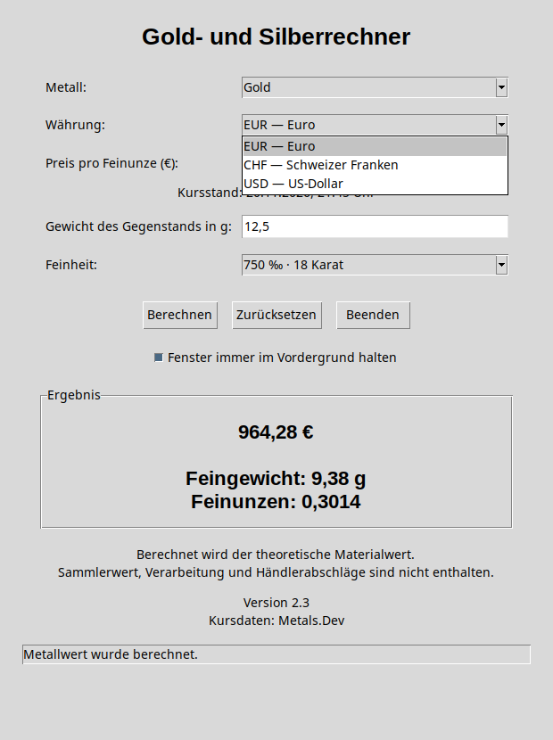
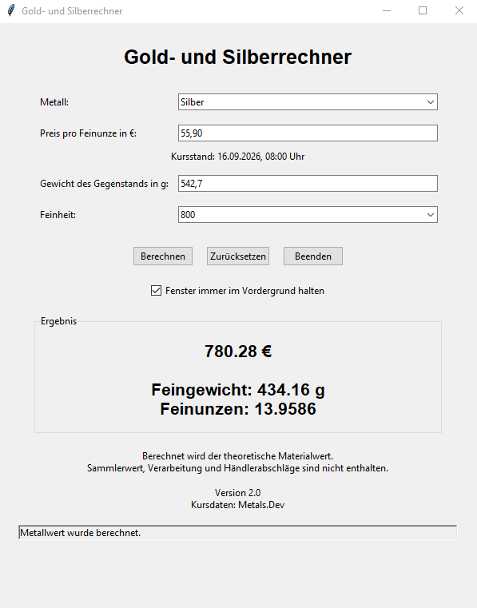

# Gold- und Silberrechner

**Español** · [Descargar la calculadora de oro y plata](https://github.com/media-vm/gold-silber-rechner/releases/tag/v2.2-es) · [Código e instrucciones](README.es.md)

Der **Gold- und Silberrechner** ist eine kostenlose Anwendung zur Berechnung des Materialwerts von Gold und Silber anhand aktueller Edelmetallkurse.

Die Anwendung eignet sich zum Beispiel zur Bewertung von Münzen, Barren, Schmuck und anderen Gegenständen aus Gold oder Silber.

## Version

Aktuelle Quellcode-Version: **2.2**

Version 2.1 wird übersprungen. Version 2.0 bleibt als frühere Quellcode-Version erhalten.

## Download

Aktuelle Desktop-Pakete: [GitHub-Release v2.2](https://github.com/media-vm/gold-silber-rechner/releases/tag/v2.2).

### Windows 11 – Version 2.2 (64 Bit)

[Gold-Silber-Rechner-2.2.exe herunterladen](https://github.com/media-vm/gold-silber-rechner/releases/download/v2.2/Gold-Silber-Rechner-2.2.exe)

Die Anwendung kann direkt gestartet werden; Python muss nicht separat installiert werden.

Die Windows-11-Datei wurde vom Herausgeber selbstsigniert und mit einem DigiCert-Zeitstempel versehen. Das Zertifikat ist nicht automatisch auf anderen Rechnern vertrauenswürdig; SmartScreen-Warnungen können weiterhin erscheinen.

SHA-256 Windows 11: `1b82765ede4c1d3addca9e2700e935ab264bebe1df4fe65210a5aaa0bfba4b2f`

Zertifikat-Fingerabdruck (SHA-1): `5F2BD8D34D846C0197AC5A58343B6FDD407DE639`

Die signierte EXE liegt zusätzlich unter `downloads/Gold-Silber-Rechner-2.2.exe`. Neue reguläre Builds werden noch nicht automatisch signiert. Der reguläre Veröffentlichungsworkflow überschreibt bestehende Release-Dateien daher nicht automatisch.

### Windows 7 – Version 2.2 (32 Bit, Kompatibilitätsbuild)

[Gold-Silber-Rechner-2.2-Windows7.exe herunterladen](https://github.com/media-vm/gold-silber-rechner/releases/download/v2.2/Gold-Silber-Rechner-2.2-Windows7.exe)

Die EXE ist mit dem selbstsignierten Herausgeberzertifikat und DigiCert-Zeitstempel signiert. SHA-256: `eaef65acea8da5afab2d025b0b7ecae3394672e72280f827cee0e06bbd41bc87`.

Dieser Build verwendet denselben Anwendungscode mit Python 3.8.10, PyInstaller 5.13.2 und einem Zoneinfo-Backport. Berechnung, Zeitzonendaten und Start der EXE wurden auf einem aktuellen Windows-CI-Runner geprüft. Ein Funktionstest auf einem echten Windows-7-Rechner steht noch aus. Die älteren Laufzeitbibliotheken sind für diesen Kompatibilitätsbuild erforderlich.

### Debian / Ubuntu – Version 2.2, Paketrevision 2.2-3

[DEB-Paket herunterladen](https://github.com/media-vm/gold-silber-rechner/releases/download/v2.2/gold-silber-rechner_2.2-3_all.deb)

```bash
sudo apt install ./gold-silber-rechner_2.2-3_all.deb
```

Das Paket enthält Deutsch und Spanisch. Die Oberfläche folgt der Systemsprache. Mit `gold-silber-rechner --lang es` kannst du Spanisch direkt wählen. [Alternativer Download von Linuga](https://linuga.org/gsr/downloads/gold-silber-rechner_2.2-3_all.deb).

SHA-256: `61415952deaa2e0babe65b86ca1c1a10593e8cc1a4728b5a777271e446e48835`

### Snap – Version 2.2 (amd64 und ARM64)

Im Snap Store im Kanal `latest/stable` verfügbar: amd64 ab Revision 6, ARM64 ab Revision 7. Bestehende Installation aktualisieren:

```bash
sudo snap refresh gold-silber-rechner
```

[amd64-Snap für lokale Installation herunterladen](https://github.com/media-vm/gold-silber-rechner/releases/download/v2.2/gold-silber-rechner_2.2_amd64.snap)

[ARM64-Snap für lokale Installation herunterladen](https://github.com/media-vm/gold-silber-rechner/releases/download/v2.2/gold-silber-rechner_2.2_arm64.snap)

Der ARM64-Snap enthält denselben Python-Quellstand. Paketinhalt, Quellcode-Prüfsumme und GUI-Start mit Beispielrechnung wurden auf einem nativen ARM64-Runner geprüft. Die öffentliche Store-Abfrage bestätigt Version 2.2, Revision 7 für ARM64.

### Android – weiterhin Version 2.0

Die Android-APK wurde noch nicht auf Version 2.2 aktualisiert. Der Android-Quellcode und ein Android-Build sind in diesem Repository nicht enthalten.

[Bisherige Android-APK aus Release v2.0](https://github.com/media-vm/gold-silber-rechner/releases/download/v2.0/gold-silver-calculator-v2.apk)

### Weitere Paketvarianten und Archiv

Ein MSIX-Paket wurde im Rahmen dieser Aktualisierung nicht für Version 2.2 erstellt oder veröffentlicht. Für ARM64 sind Build- und Veröffentlichungsworkflows vorhanden. Version 2.0 bleibt im [Release v2.0](https://github.com/media-vm/gold-silber-rechner/releases/tag/v2.0) und in der Git-Historie als Archiv erhalten.

### Projekt-Webseite

Weitere Informationen und Downloads:

https://linuga.org/gsr/

## Funktionen

- Berechnung des Materialwerts von Gold und Silber
- Eingabe des Gewichts
- Auswahl bzw. Eingabe der Feinheit
- Berechnung des enthaltenen Feingewichts
- Verwendung aktueller Gold- und Silberkurse
- übersichtliche grafische Oberfläche
- Unterstützung verschiedener Betriebssysteme

## Unterstützte Plattformen

Der Gold- und Silberrechner ist für mehrere Plattformen verfügbar:

- Windows
- Linux
- Android

Je nach Plattform stehen unterschiedliche Installationspakete zur Verfügung, darunter:

- Windows EXE
- Windows MSIX
- Debian DEB
- Snap
- Android APK

## Screenshots

### Linux



### Windows



## Quellcode

Die Desktop-Version wurde in **Python** entwickelt.

Die grafische Benutzeroberfläche verwendet Tkinter.
Die Datei `gold-silver-value-calculator-german-v2.2.py` ist der gemeinsame Entwicklungsstand für Deutsch und Spanisch. Beide Sprachen werden auf `main` gepflegt. Die veröffentlichten Pakete können einen älteren Stand enthalten.

Start aus dem Repository mit installiertem Python und Tkinter:

```bash
python -m pip install -r requirements.txt
python gold-silver-value-calculator-german-v2.2.py --lang de
```

## Code signing policy

Free code signing provided by SignPath.io, certificate by SignPath Foundation.

### Project roles

- Author / Committer: Volker Andreas Müller
- Reviewer: Volker Andreas Müller
- Approver: Volker Andreas Müller

### Privacy policy

See [PRIVACY.md](PRIVACY.md).

The application connects to `https://gsr.linuga.org/` to retrieve current gold and silver prices. It does not contain advertising, analytics or user tracking.

## Lizenz

Dieses Projekt steht unter der MIT License.

Siehe die Datei `LICENSE` im Repository.

Die aktuelle Entwicklungsfassung bietet auf Deutsch EUR, CHF und USD sowie Karatangaben und Sterlingsilber. Die zusätzlichen Währungen und Gewichtseinheiten für die spanische Oberfläche beschreibt die [spanische Anleitung](README.es.md).

## Paketbau

DEB reproduzierbar aus dem aktuellen Quellstand bauen:

```bash
python3 packaging/build-deb.py
```

Der Build auf `main` erzeugt den Entwicklungsstand als DEB-Revision 2.2-4 unter `dist/`. Der veröffentlichte DEB-Download ist Revision 2.2-3.

Windows-Pakete werden über den GitHub-Actions-Workflow `Windows Build` aus derselben Python-Datei erstellt. `Publish Windows 2.2 executables` veröffentlicht beide geprüften Artefakte eines erfolgreichen Builds. Der Windows-7-Laufzeithook stellt den Import `zoneinfo` über den Backport bereit, ohne den Anwendungscode zu verändern.
